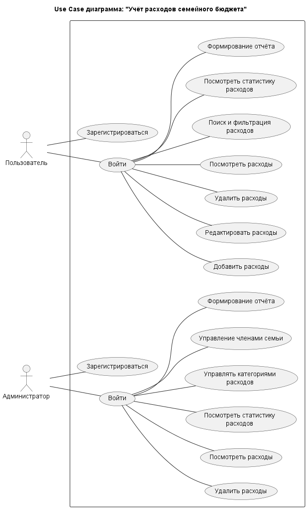
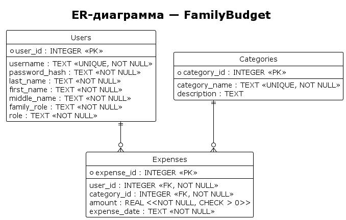
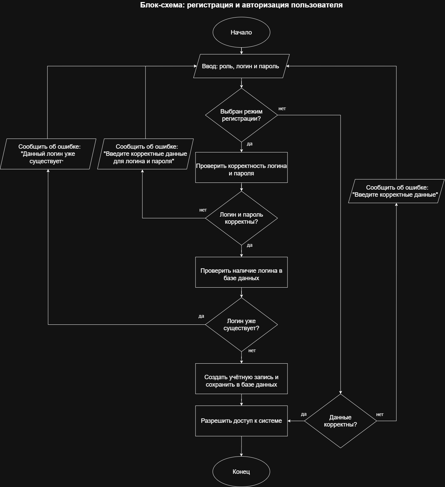
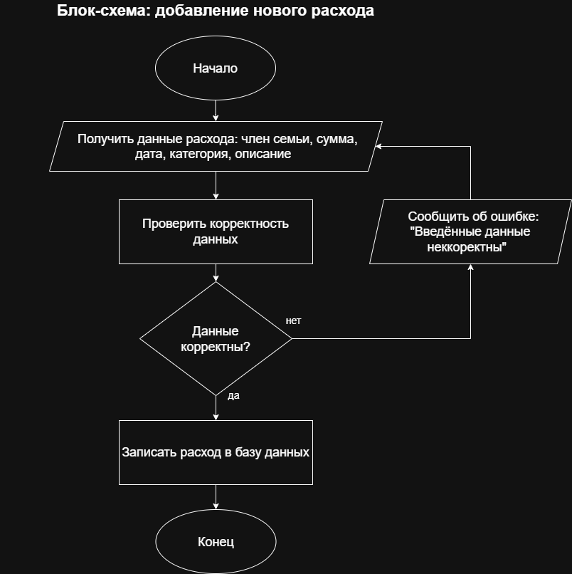
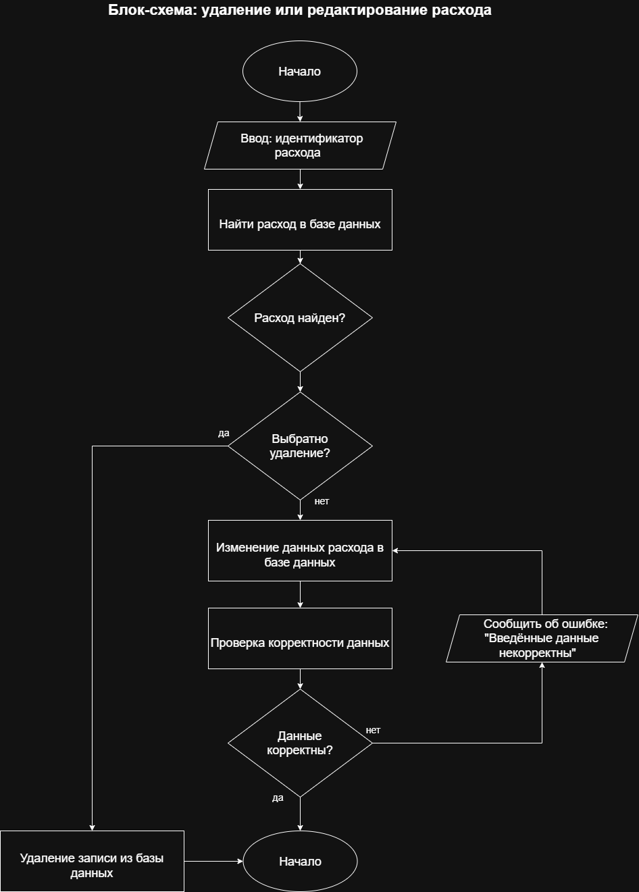
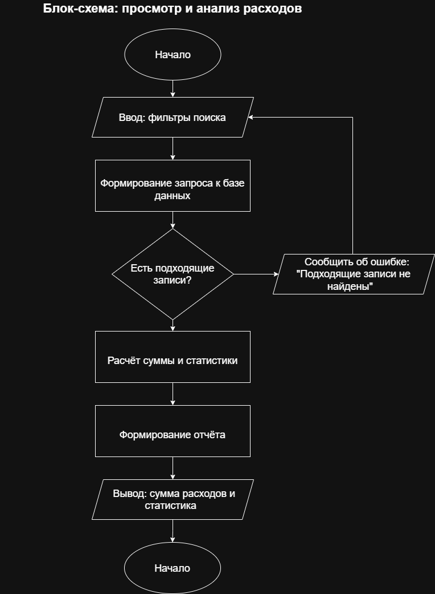

# FamilyBudget

**FamilyBudget** — консольное приложение для учёта расходов семейного бюджета. Проект предназначен для автоматизации добавления, редактирования и удаления расходов, управления категориями затрат и контроля финансов семьи.

**Автор:** Михеев Даниил, группа 26-ИВТ-4-2

## Возможности

В проекте предусмотрены следующие основные возможности:

- регистрация и авторизация пользователей;
- хранение информации о расходах семейного бюджета;
- добавление новых расходов;
- редактирование и удаление записей о расходах;
- распределение расходов по категориям;
- просмотр истории расходов;
- просмотр расходов по пользователям и категориям;
- управление категориями расходов;
- разграничение прав доступа администратора и обычного пользователя;
- хранение данных в базе данных SQLite.

## Предметная область

**Расход** — запись о совершённой финансовой операции, содержащая сумму, дату совершения, категорию и информацию о пользователе, который добавил расход.

**Категория** — группа расходов, предназначенная для классификации затрат. Каждая категория содержит название и описание.

**Пользователь** — зарегистрированный участник системы, имеющий учётную запись, персональные данные и определённую роль в семье. Для доступа к системе используются логин и хеш пароля.

**Семейная роль** — положение пользователя в семье, например отец, мать или ребёнок.

Задача системы — упростить ведение семейного бюджета, обеспечить удобный контроль расходов и помочь пользователям отслеживать распределение денежных средств.

## Пользователи и роли

| Роль | Возможности |
|---|---|
| Пользователь | Добавляет, редактирует и удаляет собственные расходы, просматривает историю своих операций |
| Администратор | Управляет пользователями, категориями и расходами, имеет расширенные права доступа |

## Структура проекта

```text
FamilyBudget/
│
├── docs/
│   ├── diagrams/
│   │   ├── ER.png
│   │   ├── ER.puml
│   │   ├── usecase.png
│   │   └── usecase.puml
│   │
│   └── flowcharts/
│       ├── add_expense.png
│       ├── analysis.png
│       ├── authentication.png
│       └── edit_delete.png
│
├── services/
│   ├── __init__.py
│   ├── auth_service.py
│   ├── user_service.py
│   ├── category_service.py
│   └── expense_service.py
│
├── database.py
├── repositories.py
├── models.py
├── exceptions.py
├── main.py
├── family_budget.db
└── README.md
```

### Описание папок и файлов

- **`docs/`** — папка для хранения документации проекта и графических материалов.
  - **`diagrams/`** — папка с диаграммами, описывающими структуру базы данных и функциональность системы.
    - `ER.png` — изображение ER-диаграммы базы данных.
    - `ER.puml` — исходный код ER-диаграммы на языке PlantUML.
    - `usecase.png` — изображение диаграммы вариантов использования (Use Case).
    - `usecase.puml` — исходный код диаграммы вариантов использования на языке PlantUML.
  - **`flowcharts/`** — папка с блок-схемами основных процессов программы.
    - `add_expense.png` — блок-схема добавления нового расхода.
    - `analysis.png` — блок-схема просмотра и анализа расходов.
    - `authentication.png` — блок-схема регистрации и авторизации пользователей.
    - `edit_delete.png` — блок-схема редактирования и удаления расходов.

- **`services/`** — папка, содержащая сервисный слой приложения.
  - `__init__.py` — файл инициализации Python-пакета.
  - `auth_service.py` — регистрация пользователей, авторизация и проверка паролей.
  - `user_service.py` — управление пользователями и проверка пользовательских данных.
  - `category_service.py` — управление категориями расходов.
  - `expense_service.py` — управление расходами и проверка корректности операций.

- **`database.py`** — модуль для создания базы данных, таблиц и подключения к SQLite. Также выполняет добавление стандартных категорий расходов при подготовке базы данных.
- **`repositories.py`** — модуль доступа к данным, содержащий операции добавления, получения, изменения и удаления записей.
- **`models.py`** — модуль с моделями данных `User`, `Category` и `Expense`.
- **`exceptions.py`** — модуль с пользовательскими исключениями для обработки ошибок.
- **`main.py`** — главный файл программы, отвечающий за запуск приложения, отображение меню, ввод и вывод информации.
- **`family_budget.db`** — файл базы данных SQLite, содержащий сведения о пользователях, категориях и расходах.
- **`README.md`** — файл с описанием проекта, его назначения, структуры и используемых технологий.

## Диаграммы проекта

### 1. Use-Case диаграмма

Диаграмма вариантов использования отображает взаимодействие пользователей с системой учёта расходов семейного бюджета и основные функции приложения.

Исходный файл: [`usecase.puml`](docs/diagrams/usecase.puml)



### 2. ER-диаграмма базы данных

ER-диаграмма отображает структуру базы данных, основные сущности, их атрибуты, первичные и внешние ключи, а также связи между таблицами `Users`, `Categories` и `Expenses`.

Исходный файл: [`ER.puml`](docs/diagrams/ER.puml)



## Структура базы данных

База данных `family_budget.db` создана с использованием SQLite. Она включает три таблицы: `Users`, `Categories` и `Expenses`.

### Таблица `Users`

Содержит информацию о зарегистрированных пользователях системы, их персональные данные и роли.

| Поле | Тип данных | Ограничения | Описание |
|---|---|---|---|
| `user_id` | INTEGER | PRIMARY KEY | Уникальный идентификатор пользователя |
| `username` | TEXT | UNIQUE, NOT NULL | Уникальный логин пользователя для входа в систему |
| `password_hash` | TEXT | NOT NULL | Хеш пароля пользователя |
| `last_name` | TEXT | NOT NULL | Фамилия пользователя |
| `first_name` | TEXT | NOT NULL | Имя пользователя |
| `middle_name` | TEXT | NOT NULL | Отчество пользователя |
| `family_role` | TEXT | NOT NULL | Положение пользователя в семье (отец, мать, ребёнок и т. д.) |
| `role` | TEXT | NOT NULL, DEFAULT 'user', CHECK | Роль пользователя в системе: администратор (`admin`) или обычный пользователь (`user`) |

### Таблица `Categories`

Содержит категории расходов семейного бюджета, предназначенные для классификации финансовых операций.

| Поле | Тип данных | Ограничения | Описание |
|---|---|---|---|
| `category_id` | INTEGER | PRIMARY KEY | Уникальный идентификатор категории |
| `category_name` | TEXT | UNIQUE, NOT NULL | Уникальное название категории расходов |
| `description` | TEXT | — | Описание категории расходов |

### Таблица `Expenses`

Содержит записи о расходах пользователей. Каждая запись связана с конкретным пользователем и одной из категорий расходов.

| Поле | Тип данных | Ограничения | Описание |
|---|---|---|---|
| `expense_id` | INTEGER | PRIMARY KEY | Уникальный идентификатор расхода |
| `user_id` | INTEGER | FOREIGN KEY, NOT NULL | Идентификатор пользователя, добавившего расход |
| `category_id` | INTEGER | FOREIGN KEY, NOT NULL | Идентификатор категории расхода |
| `amount` | REAL | NOT NULL, CHECK (amount > 0) | Сумма расхода в рублях |
| `expense_date` | TEXT | NOT NULL | Дата совершения расхода в формате ГГГГ-ММ-ДД |

## Связи между таблицами

В базе данных используются две связи типа «один ко многим»:

- **Users — Expenses (один ко многим).** Один пользователь может добавить несколько записей о расходах, но каждая запись связана только с одним пользователем. Связь реализована с помощью внешнего ключа `user_id` в таблице `Expenses`.

- **Categories — Expenses (один ко многим).** Одна категория может использоваться во многих записях о расходах, но каждый расход относится только к одной категории. Связь реализована с помощью внешнего ключа `category_id` в таблице `Expenses`.

Таким образом, таблица `Expenses` является связующей сущностью между пользователями и категориями расходов.

## Обеспечение целостности данных

В базе данных используются следующие ограничения:

- **PRIMARY KEY (PK)** — обеспечивает уникальность каждой записи в таблице.
- **FOREIGN KEY (FK)** — связывает расходы с существующими пользователями и категориями.
- **UNIQUE** — предотвращает повторение логинов пользователей и названий категорий.
- **NOT NULL** — запрещает отсутствие значений в обязательных полях.
- **CHECK** — обеспечивает положительное значение суммы расхода и допустимые значения системной роли пользователя.
- **DEFAULT** — устанавливает роль `user` для нового пользователя, если другое значение не указано.

## Блок-схемы процессов

В документации проекта предусмотрены блок-схемы основных процессов:









## Инструкция по использованию

### 1. Подготовка проекта

Перед запуском программы необходимо убедиться, что на компьютере установлен Python 3.

Скачайте или клонируйте проект из репозитория GitHub и откройте папку `FamilyBudget` в Visual Studio Code или другой среде разработки.

### 2. Создание базы данных

Для создания базы данных и необходимых таблиц используется файл `database.py`.

Откройте терминал в корневой папке проекта и выполните команду:

```bash
python database.py
```

После выполнения команды автоматически создаётся файл `family_budget.db`, содержащий три таблицы:

- `Users` — информация о зарегистрированных пользователях;
- `Categories` — категории расходов;
- `Expenses` — записи о расходах.

При подготовке базы данных в таблицу `Categories` автоматически добавляются 28 стандартных категорий расходов.

Повторный запуск `database.py` не приводит к повторному добавлению уже существующих категорий.

### 3. Запуск программы

Для запуска приложения выполните команду:

```bash
python main.py
```

После запуска откроется главное меню программы.

### 4. Создание первого администратора

При первом запуске программы, если в базе данных ещё нет зарегистрированных пользователей, система предложит создать учётную запись первого администратора.

После заполнения данных учётная запись администратора будет сохранена в таблице `Users`.

Пароль хранится в виде хеша, поэтому в базе данных не сохраняется его исходное значение.

### 5. Авторизация пользователей

После создания администратора для входа в систему необходимо выбрать пункт «Войти в систему».

Система проверяет введённые данные и определяет права доступа пользователя в соответствии с его системной ролью.

### 6. Регистрация новых пользователей

Регистрация дополнительных пользователей выполняется администратором через соответствующий пункт меню управления пользователями.

При создании новой учётной записи необходимо указать логин, пароль, фамилию, имя, отчество и семейную роль.

Новые пользователи автоматически получают системную роль `user`.

После регистрации пользователь может самостоятельно войти в систему, используя созданные логин и пароль.

### 7. Работа с расходами

После успешной авторизации пользователю становится доступно меню управления расходами.

Основные операции:

- **Добавление расхода** — ввод суммы, выбор категории и указание даты совершения расхода.
- **Просмотр расходов** — отображение сохранённых записей о расходах.
- **Редактирование расхода** — изменение информации о ранее добавленной записи.
- **Удаление расхода** — удаление выбранной записи из базы данных.

Обычный пользователь может работать только со своими расходами, а администратор имеет доступ к расширенным возможностям управления записями.

### 8. Управление категориями

Администратор может просматривать список категорий, добавлять новые категории, изменять их названия и описания, а также удалять категории, которые не используются в расходах.

При создании базы данных автоматически добавляются 28 стандартных категорий, поэтому вручную создавать их повторно не требуется.

### 9. Завершение работы

Для выхода из учётной записи необходимо выбрать соответствующий пункт меню.

Для полного завершения программы используется пункт «Выход» в главном меню.

Все изменения сохраняются в базе данных `family_budget.db` и остаются доступными при последующих запусках приложения.

## Требования

Для работы с проектом необходимы:

- Python 3;
- SQLite3 (входит в стандартную библиотеку Python);
- Git.

## Используемые технологии

- **Python** — разработка приложения;
- **SQLite** — хранение данных;
- **Git и GitHub** — контроль версий и размещение проекта;
- **Visual Studio Code** — среда разработки;
- **PlantUML** — создание диаграмм;
- **Markdown** — оформление документации.

## Статус проекта

Проект находится в разработке. Функциональность и структура приложения могут изменяться по мере реализации.

## Лицензия

Проект является учебным.