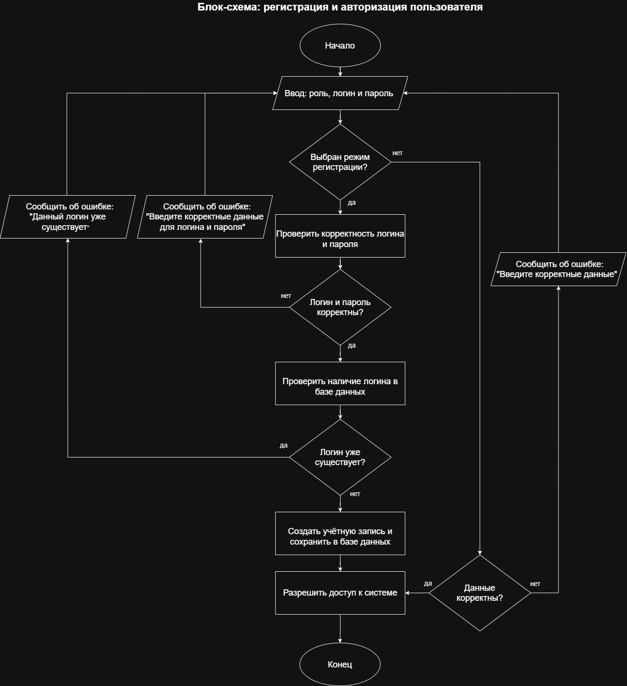
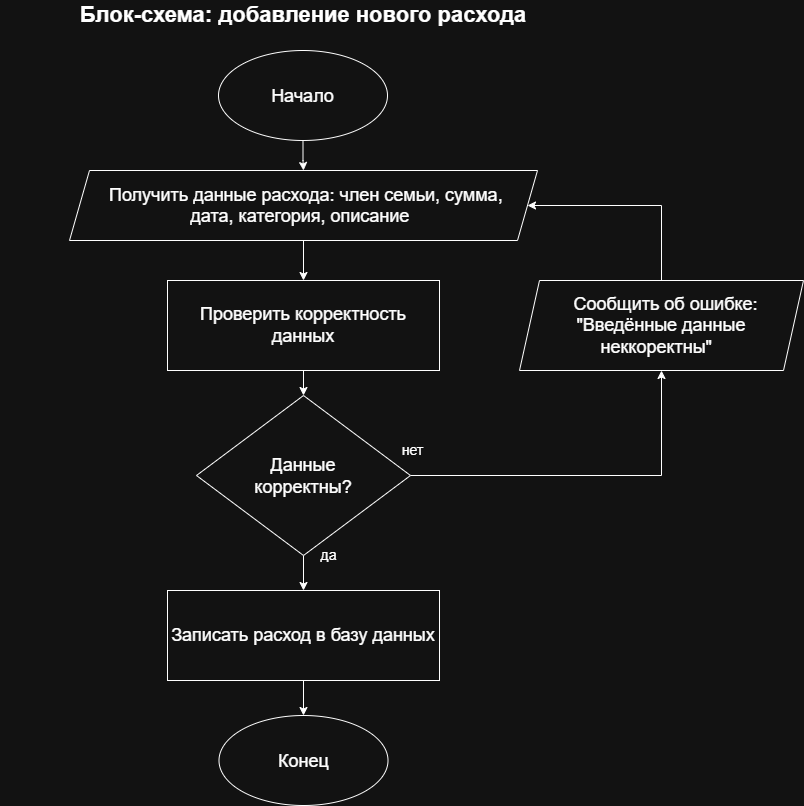
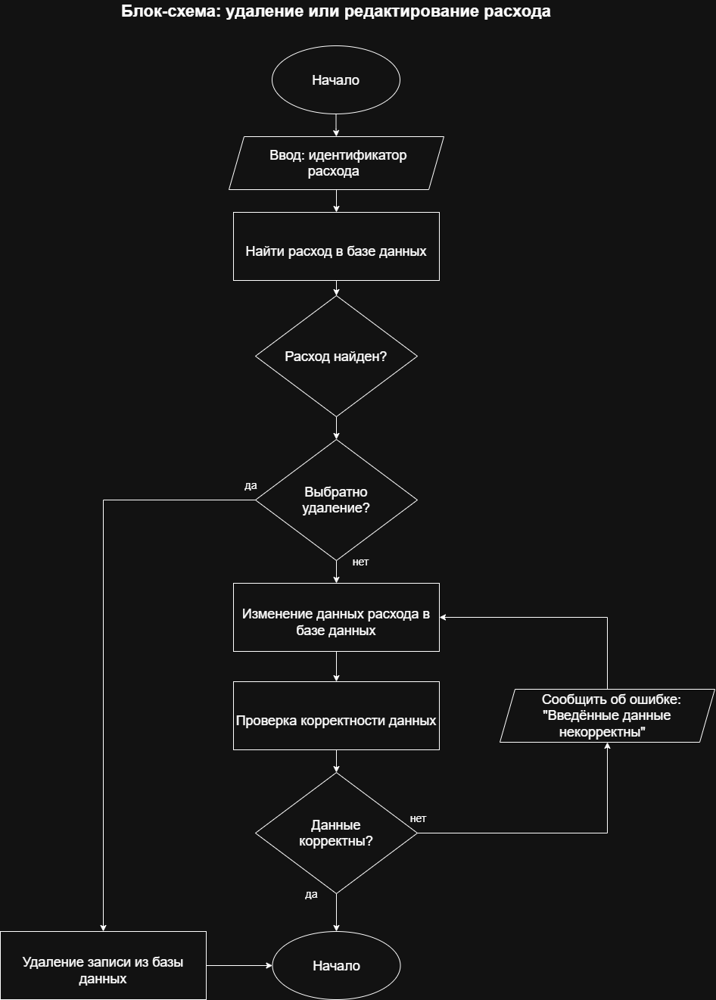
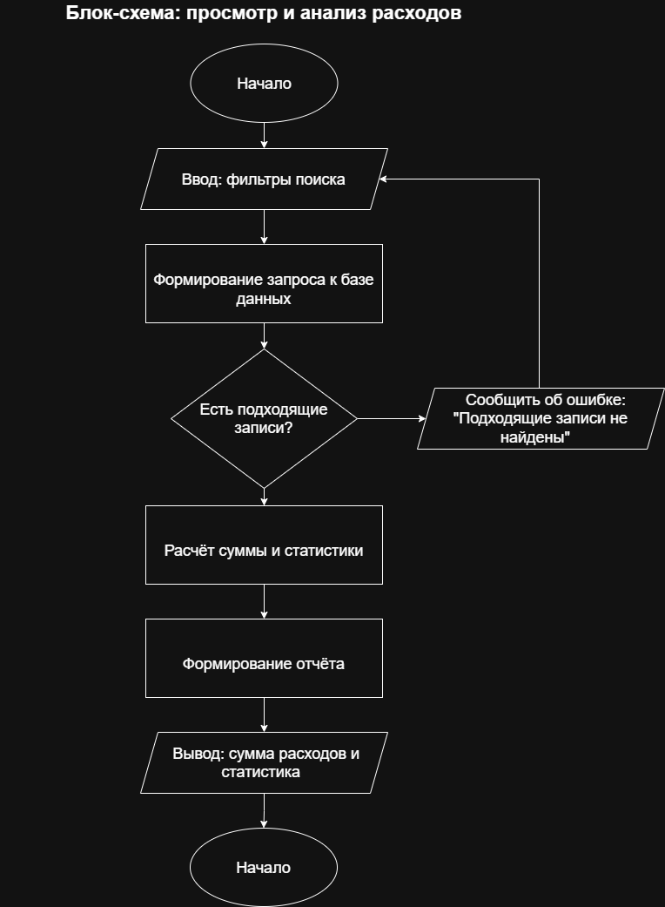

# FamilyBudget

FamilyBudget - консольное приложение для учёта расходов семейного бюджета. Проект предназначен для автоматизации добавления, редактирования и удаления расходов, управления категориями затрат и анализа финансов семьи.

**Автор:** Михеев Даниил, группа 26-ИВТ-4-2

## Возможности

В проекте предусмотрены следующие основные возможности:

- регистрация и авторизация пользователей;
- хранение информации о расходах семейного бюджета;
- добавление новых расходов;
- редактирование и удаление записей о расходах;
- распределение расходов по категориям;
- поиск и фильтрация расходов по различным параметрам;
- просмотр истории расходов;
- анализ расходов за выбранный период;
- формирование статистики и отчётов;
- хранение данных в базе данных SQLite.

## Предметная область

**Расход:** сумма, дата, категория, описание и пользователь, создавший запись.

**Категория:** название и описание категории расходов, например «Продукты», «Транспорт», «Коммунальные услуги» и «Развлечения».

**Пользователь:** идентификатор, логин и данные для авторизации в системе.

**Семья:** информация о семье и её участниках, если предусмотрен совместный учёт расходов.

Задача системы — упростить ведение семейного бюджета, обеспечить удобный контроль расходов и помочь пользователям анализировать распределение денежных средств.

## Пользователи и роли

| Роль | Возможности |
|---|---|
| Пользователь | Добавляет, редактирует и удаляет расходы, просматривает историю операций, использует фильтры и анализирует затраты |
| Администратор | Управляет пользователями и контролирует работу системы, если соответствующая роль предусмотрена |

## Структура проекта

```text  
FamilyBudget/
│
├── .idea/                                 
│   ├── inspectionProfiles/
│   │   └── profiles_settings.xml            
│   ├── .gitignore
│   ├── misc.xml
│   ├── modules.xml
│   └── FamilyBudget.iml
│
├── docs/
│   ├── diagrams/
│   │   └── usecase.puml
│   └── flowcharts/
│       ├── add_expense.png
│       ├── analysis.png
│       ├── authentication.png
│       └── edit_delete.png
├── main.py
└── README.md
Python
```
### Описание файлов и папок

- **`.idea/`** — каталог, содержащий настройки проекта для среды разработки PyCharm.
- **`docs/`** — каталог для хранения документации проекта.
- **`diagrams/`** — папка для хранения диаграмм, описывающих взаимодействие пользователей с системой.
- **`usecase.puml`** — исходный код Use Case диаграммы вариантов использования, созданной на языке PlantUML.
- **`flowcharts/`** — каталог с изображениями блок-схем основных процессов приложения.
- **`add_expense.png`** — блок-схема процесса добавления нового расхода в семейный бюджет.
- **`analysis.png`** — блок-схема процесса просмотра и анализа расходов за выбранный период.
- **`authentication.png`** — блок-схема процесса регистрации и авторизации пользователей.
- **`edit_delete.png`** — блок-схема процесса редактирования и удаления записей о расходах.
- **`main.py`** — главный файл приложения, предназначенный для запуска программы и выполнения основных операций.
- **`README.md`** — основной файл документации, содержащий описание проекта, его возможностей и структуры.

## Блок-схемы процессов

В документации проекта предусмотрены блок-схемы основных процессов:









## Требования

Для работы с проектом необходимы:

- Python 3;
- Git;

## Используемые технологии

- **Python** — разработка приложения;
- **Git и GitHub** — контроль версий и размещение проекта;
- **Visual Studio Code** — среда разработки;
- **PlantUML** — создание диаграмм;
- **Markdown** — оформление документации.

## Статус проекта

Проект находится в разработке. Функциональность и структура приложения могут изменяться по мере реализации.

## Лицензия

Проект является учебным.